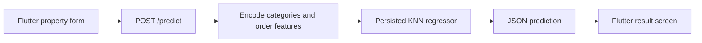

# HousePrice Estimator

A Flutter and Python machine learning prototype that estimates property prices from location, city, property type, room counts, and area in marla.

The project connects a form-based client to a FastAPI inference service and a persisted K-nearest-neighbors model. It demonstrates categorical preprocessing, a typed prediction API, and model integration in an interactive application.

## Stack

| Layer | Technologies |
| --- | --- |
| Client | Flutter, Dart `^3.8.1`, `http` |
| API | Python, FastAPI, Pydantic, Uvicorn |
| Inference | scikit-learn, pandas, NumPy, Joblib |
| Training | Jupyter notebook in `backend/model/train_model.ipynb` |

Python packages are pinned in [backend/requirements.txt](backend/requirements.txt), including scikit-learn 1.7.0. Use a Python environment compatible with those pins and the saved estimator.

## Architecture



The API loads the model and city/location encoders on import. Preprocessing maps property type, transforms categories using the saved encoders, and preserves the training feature order. The form, request, and results are implemented under `frontend/lib/screens/`.

## Setup

```sh
git clone https://github.com/Abdul-Hadi-Jalil/HousePrice-Estimator.git
cd HousePrice-Estimator
python -m venv backend/.venv
```

Activate the environment (`backend/.venv/Scripts/Activate.ps1` on PowerShell or `source backend/.venv/bin/activate` on bash), then:

```sh
python -m pip install -r backend/requirements.txt
cd backend
python -m uvicorn main:app --reload --host 0.0.0.0 --port 8000
```

The following artifacts must be available in `backend/model/`:

- `knn_model_house_price_estimator.joblib`
- `label_encoder_city.joblib`
- `label_encoder_location.joblib`

They are present in the source tree. Load only trusted model artifacts.

In a second terminal:

```sh
cd frontend
flutter pub get
flutter devices
flutter run -d <device-id>
```

The client currently hardcodes `http://127.0.0.1:8000/predict` in `frontend/lib/screens/input_form_screen.dart`. For an Android emulator, change the host to `10.0.2.2`; for a physical device, use an accessible LAN address or USB port reversal. No API-key environment variables are implemented.

## API

Open `http://127.0.0.1:8000/docs` and submit `POST /predict`:

```json
{
  "location": "G-10",
  "property_type": "Flat",
  "city": "Karachi",
  "baths": 4,
  "bedrooms": 5,
  "Area_in_Marla": 20
}
```

The response contains a numeric `prediction`. Choose categories that exist in the saved encoders; an unknown city/location is not handled by a dedicated fallback.

## Validation and scope

Run `flutter analyze` and `flutter test` from `frontend/`, then exercise the API and form together. Automated regression checks and a documented held-out evaluation are useful next steps; no accuracy or production-valuation claim is made here.

The estimator depends on the training data's geography, date, categories, and price units. Inspect the notebook before interpreting its output. This is a portfolio inference prototype and needs input validation, robust error handling, deployment configuration, and measured model evaluation before operational use.
